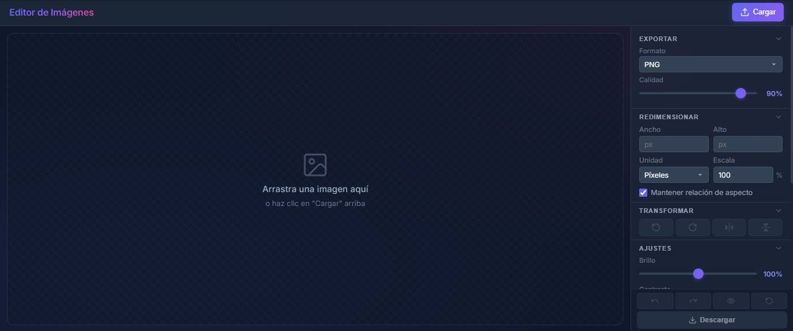

<div align="center">


# Editor de Imágenes Web


[Características](#características) • [Inicio rápido](#inicio-rápido) • [Uso](#uso) • [Cómo funciona](#cómo-funciona) • [Atajos](#atajos-de-teclado) • [Problemas comunes](#problemas-comunes)



</div>

Editor de imágenes completo que corre **100% en el navegador**: sin backend, sin instalación y sin subir tus imágenes a ningún servidor. Todo el procesamiento se hace en local con Canvas API.

> [!TIP]
> Sirve el proyecto por HTTP (`python -m http.server 8000`) en lugar de abrir `index.html` directamente: así evitas restricciones de CORS y Canvas.

## Características

**Carga y recorte**
- Carga por clic en "Cargar", arrastrar y soltar sobre el canvas, o clic en el estado vacío. Validación de tipo y tamaño (máx. 10 MB).
- Recorte interactivo con Cropper.js y panel informativo en el header (dimensiones, peso, formato).

**Ajustes y filtros**
- Brillo, contraste y saturación (0–200 %) con previsualización en tiempo real.
- Filtros: original, escala de grises, sepia e invertir.
- Rotación ±90° y volteo horizontal/vertical.

**Eliminación de fondo**
- Selector de color + tolerancia, con modo *flood fill desde bordes* (preserva elementos internos del mismo color) o modo global.

**Exportación**
- Formatos JPEG, PNG y WEBP con control de calidad y compresión en cliente.
- El formato cambia automáticamente a PNG si la imagen tiene transparencia.
- El archivo descargado conserva el nombre original con sufijo `_edited`.

**Productividad y accesibilidad**
- Deshacer/rehacer (20 estados), comparación A/B manteniendo pulsado, y reseteo total.
- Notificaciones toast, indicador de carga, atajos de teclado y controles ARIA.
- Sidebar con secciones colapsables para organizar las herramientas.
- Respeta `prefers-reduced-motion`, objetivos táctiles ≥ 44 px y diseño responsive.

## Inicio rápido

Sin instalación ni dependencias. Solo necesitas un navegador moderno y un servidor HTTP local:

```powershell
python -m http.server 8000
# o bien
npx http-server -p 8000
```

Abre `http://localhost:8000` y arrastra una imagen al área de carga.

## Uso

1. **Carga** una imagen con el botón "Cargar" en el header, arrastrando sobre el canvas, o haciendo clic en el área vacía.
2. **Edita** con el panel lateral: ajusta el recorte arrastrando el cuadro, mueve los sliders, aplica un filtro o activa la eliminación de fondo.
3. **Descarga** con el botón verde (o `Ctrl+S`) en el formato y calidad elegidos.

### Layout de la interfaz

```
┌─────────────────────────────────────────────┬──────────────┐
│  Editor de Imágenes   [info]   [Cargar]     │              │
├─────────────────────────────────────────────┤   SIDEBAR    │
│                                             │              │
│              CANVAS / IMAGEN                │  Exportar    │
│           (área de recorte)                 │  Redimens.   │
│                                             │  Transformar │
│                                             │  Ajustes     │
│                                             │  Filtros     │
│                                             │  Fondo       │
├─────────────────────────────────────────────┼──────────────┤
│                                             │ [↺][↪][👁][⚡]│
│                                             │ [Descargar]  │
└─────────────────────────────────────────────┴──────────────┘
```

El sidebar es scrolleable y sus secciones son colapsables para ahorrar espacio.

## Cómo funciona

```
archivo → handleFileSelect() → Cropper.js sobre #imagePreview
    → controles → applyTransformations() → preview en #maskPreview
    → Descargar → processAndDownload() → Compressor.js → FileSaver.js
```

- El **preview** no reemplaza la imagen: se renderiza en un canvas (`#maskPreview`) superpuesto al área de recorte.
- Vista previa y descarga comparten la misma lógica de píxeles (brillo/contraste/saturación, filtros, fondo), aplicada en una sola pasada.
- El fondo se elimina con *flood fill* (BFS) desde el perímetro: solo desaparece lo conectado a los bordes.
- El procesamiento es síncrono en el hilo principal; imágenes de ~4000 px o más pueden congelar la UI unos instantes y las de más de ~25 MP muestran un aviso.

## Atajos de teclado

| Atajo | Acción |
|-------|--------|
| `Ctrl+S` | Descargar imagen |
| `Ctrl+Z` / `Ctrl+Y` | Deshacer / rehacer |
| `Escape` | Resetear cambios |
| `Ctrl+←` / `Ctrl+→` | Rotar 90° |

## Tecnologías

| Librería | Versión (CDN) | Uso |
|----------|---------------|-----|
| [Cropper.js](https://github.com/fengyuanchen/cropperjs) | 1.5.12 | Recorte interactivo |
| [Compressor.js](https://github.com/fengyuanchen/compressorjs) | 1.1.1 | Compresión antes de descargar |
| [FileSaver.js](https://github.com/eligrey/FileSaver.js/) | 2.0.5 | Guardar el archivo final |
| Inter (Google Fonts) | — | Tipografía |

> [!NOTE]
> Las librerías cargan desde CDN, así que la primera visita necesita conexión a internet.

## Estructura del proyecto

```
.
├── index.html      # Único punto de entrada: DOM + carga de CDN y js/main.js
├── js/main.js      # Toda la lógica (dentro de un closure DOMContentLoaded)
├── css/style.css   # Tema oscuro con variables :root, por secciones
└── assets/img/     # Capturas para este README
```

Los agentes de IA tienen guía propia en `AGENTS.md`.

## Problemas comunes

| Síntoma | Causa probable | Solución |
|---------|----------------|----------|
| La imagen no carga | Formato no soportado o archivo > 10 MB | Usa JPG/PNG/WEBP/GIF de menos de 10 MB |
| `Cropper is not defined` en consola | El CDN no cargó (sin red) | Revisa tu conexión e intérnalo de nuevo |
| La UI se congela unos segundos | Imagen muy grande procesada píxel a píxel | Reduce la resolución antes de cargarla |
| El fondo borra partes del sujeto | El sujeto toca el borde o tolerancia alta | Baja la tolerancia; el flood fill parte del perímetro |
| El JPEG descargado sale como PNG | Hay píxeles transparentes | Es el comportamiento esperado: PNG conserva la transparencia |
